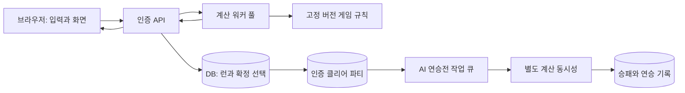

# 클래식 클리어 파티 인증 및 AI 연승전 설계안

작성일: 2026-10-24. 대상: 현재 로컬 PokéRogue 1.12.1.3 소스.

이 문서는 설계안이다. 인증 서버나 성능 벤치마크를 구현·실행한 결과가 아니다. 수용 인원과 기간은 아래 가정에 따른 계획 수치이며, 현재 저장 API의 백엔드 구현은 확인하지 못했다.

## 1. 권장 결정

**기존 클래식의 재도전을 허용한다면, 서버가 발급한 시작 조건과 전체 선택 기록을 클리어 후 비동기로 재생해 규칙을 검증하는 방식을 첫 출시안으로 권장한다. 결과를 미리 보고 되돌리는 것까지 막아야 한다면 선택 단위 온라인 확정 방식으로 강화한다.**

이 문서에서 A는 사후 규칙 검증, B는 선택 단위 온라인 확정이다. A의 인증은 '서버 규칙으로 재현되는 클리어 파티'라는 뜻이며, 미래 결과를 살펴보거나 재도전하지 않았다는 증명은 아니다. B는 이보다 강한 진행 제약을 제공한다. 기존 코드에 재도전 옵션이 있으므로 재도전 금지를 조작 방지의 필수 조건으로 자동 가정하지 않는다.

두 방식 모두 화면·음악·애니메이션·메뉴 탐색은 브라우저에서 처리한다. 서버는 매 프레임 실행하지 않으며, 사용자별 프로세스나 브라우저도 띄우지 않는다. A의 서버 부하는 초당 인증 신청 수와 완주 재생 CPU 비용, B의 서버 부하는 초당 선택 수와 선택 처리 비용이 중심이다. AI 연승전 작업은 인증 계산과 별도 동시성 한도를 사용한다.

## 2. 인증의 의미와 한계

공통으로 인증하는 조건은 다음과 같다.

- 서버가 인정한 시작 조건에서 시작했다.
- 모든 상태 변경은 서버 규칙에 따라 계산되었다.
- 서버가 정한 클리어 조건을 달성한 상태에서 파티가 추출되었다.
- 등록 이후 파티 원본은 수정되지 않는다.

A에서는 제출된 한 경로 전체를 서버가 다시 계산한다. 클라이언트가 재도전하며 다른 경로를 탐색했는지는 확인하지 못한다. B는 추가로 결과를 확인한 뒤 이전 선택으로 돌아가거나 여러 분기를 제출하는 것을 차단한다.

사용자 PC가 한 번도 수정되지 않았다는 사실을 증명하는 것은 목표가 아니다. PC의 코드를 바꿔도 인증된 파티와 결과를 위조할 수 없도록 한다. 외부 공략 계산기, 사람이 아닌 입력 자동화, 다중 계정까지 이 구조만으로 차단되지는 않는다. 서버 버그로 생기는 부정한 상태 역시 별도 회귀 검사와 수정이 필요하다.

재도전 정책은 인증 규칙에 포함한다. A는 재도전 횟수나 외부 탐색 여부를 인증 항목에 넣지 않는다. B의 엄격한 정책은 패배 확정 후 런 종료, 새로고침·재접속 시 마지막 서버 상태에서 재개이다. B에서도 재도전을 허용할 수 있지만 횟수·복구 지점을 서버가 관리하고 별도 규칙 버전으로 기록해야 한다.

## 3. 대안 비교

| 방식 | 강점 | 남는 문제 | 판단 |
|---|---|---|---|
| 최종 세이브 범위 검사 | 빠르고 저렴함 | 정상 범위로 만든 조작 파티를 구별하지 못함 | 인증 근거로 부족 |
| 클리어 후 전체 입력 로그 재생 | 정상 규칙으로 가능한 클리어인지 확인, 접속 중 지연이 적음 | 결과를 미리 보고 분기를 탐색한 뒤 성공 로그만 제출 가능, 클리어 시 검증 대기 발생 | 기존 재도전을 허용하는 첫 출시안 A |
| 층마다 로그 검증·확정 | 호출 횟수가 적고 이전 층으로의 복귀 차단 | 현재 층 안에서 결과를 보고 재선택 가능 | 층 단위 재시도를 허용할 때만 적합 |
| 선택 먼저 확정 후 서버 계산 | 상태 조작·분기 재제출·난수 예측 억제 | 매 선택에 통신 필요, 서버용 실행 경로 개발 필요 | 되돌리기 차단까지 요구할 때 강화안 B |

서버가 시드를 발급하거나 로그에 해시를 연결하는 것만으로 마지막 두 방식의 차이가 없어지지는 않는다. 클라이언트가 결과를 미리 계산할 수 있고 제출할 분기를 고를 수 있으면, 선택을 한 번만 제출했다는 사실은 정직한 플레이의 증명이 아니다.

어떤 대안을 택해도 시작 상태의 신뢰성과 규칙 전체의 재현이 필요하다. 사후 재생 방식도 최종 파티만 검사하는 간단한 기능은 아니다.

사후 재생 방식은 등록을 신청한 완주 로그에 대해서만 계산할 수 있으므로 실패·중단 런까지 처리하는 선택 단위 방식보다 총 CPU 비용을 줄일 여지가 있다. 다만 반복 검증 요청에는 한도가 필요하고, 클라이언트에서 결과를 탐색한 뒤 성공 로그만 제출하는 행위를 구별하지 못한다. 이 비용 절감과 인증 의미의 차이는 제품 결정이다.

## 4. 구조

A의 기본 흐름:


A에서는 플레이하는 동안 매 턴 서버 응답을 기다리지 않는다. 최종 제출 후 상태를 접수 → 검증 중 → 인증 완료 또는 불일치로 표시하며, 인증 완료된 파티만 연승전에 사용한다. 이미 인증된 파티로는 새 인증 작업이 진행되는 동안에도 연승전을 할 수 있다.

B로 강화할 때의 흐름:



초기 구성은 인증 API, 고정 개수 계산 워커, 관계형 DB로 시작한다. 로그와 체크포인트도 처음에는 같은 DB에 둘 수 있다. Redis, 별도 메시지 브로커, Kubernetes는 처음부터 필수로 두지 않는다. DB의 pending 선택 목록을 작업 큐로 사용하면 수락한 요청과 큐 등록 사이의 유실도 줄일 수 있다.

CPU 계산은 API 이벤트 루프 밖의 워커 풀에서 실행한다. 워커는 사람 수가 아니라 CPU·메모리 예산에 맞춰 제한한다. 워커 한 개에서 기존 전역 엔진의 두 런을 비동기로 섞어 실행하지 않는다.

### 4.1. 기본안 A의 처리 순서

1. `POST /certified-runs`에서 계정, 고정 규칙, 허용 시작 파티를 검사하고 런 ID와 서버 생성 시드·시작 manifest를 내구 저장한다. 기존 계정의 해금 상태를 신뢰할 수 있는지는 별도로 확인한다.
2. 브라우저는 버튼 좌표가 아니라 기술·대상·포획·보상·리롤·융합 등 의미 있는 모든 선택을 순서대로 기록한다. 입력 수집은 UI의 각 버튼에 흩뿌리기보다 공통 InputPort로 연결한다.
3. 로그는 묶어서 업로드해 끊김 때의 손실을 줄일 수 있다. 서버 수신 해시나 청크 순서는 전송의 일관성 확인용이며, 플레이의 정직함을 증명하지 않는다. 재도전이 기록된 경우 서버가 재현할 경로와 복구 지점을 규칙에 맞게 표현하되, 기록에 없는 탐색이 없었다고 주장하지 않는다.
4. `POST /certified-runs/{id}/submit`은 최종 로그를 고정하고 작업을 등록한다. 제출된 로그의 내용 해시·계정·런 ID로 중복 작업을 막고 상태를 즉시 응답한다. 업로드 완료와 작업 접수는 내구적으로 연결한다.
5. 워커는 서버에 저장된 시작 manifest로 새 게임을 만들고 로그의 선택만 소비한다. 클라이언트의 중간 파티·HP·아이템·난수 결과·최종 승리 주장은 계산 입력으로 쓰지 않는다. 시작부터 클리어까지 실제 규칙을 모두 실행한다.
6. 현재 prompt에서 불가능한 행동, 누락된 입력, 게임 종료 후 남은 게임 행동, 클리어 조건 미달이 있으면 인증하지 않는다. 엔진 오류·버전 누락은 불일치 판정과 구분해 복구 대기로 둔다.
7. 성공 시 워커가 계산한 최종 파티와 modifier에서 인증 파티를 생성한다. 인증 완료와 파티 발급을 같은 트랜잭션에서 처리해 중복 발급을 막는다. 클라이언트의 최종 파티 복사본은 진단용 비교에만 쓴다.

기본 API는 런 생성, 로그 청크 업로드, 최종 제출, 검증 상태 조회의 네 종류로 시작할 수 있다. 최종 로그 한 번만 업로드하는 첫 실험도 가능하지만 모바일의 탭 종료·저장 유실은 별도로 다뤄야 한다. 검증된 파티 등록 API에 임의 PokemonData를 직접 넣는 경로는 만들지 않는다.

재도전·불러오기를 기록할 때는 재현기가 스스로 만든 유효한 저장 경계에 대한 참조를 사용한다. 클라이언트의 저장 파티를 재현 중간 상태로 주입하지 않는다. 단순히 버튼 기록의 앞부분을 지우면 원본의 재로딩 시 RNG·턴 초기화와 달라질 수 있으므로, 재도전·탭 종료 후 재개·일반 연속 진행의 재현을 각각 시험해야 한다. 생략된 오프라인 탐색까지 없었다고 증명할 수는 없다는 A의 한계는 그대로다.

A의 워커는 한 런을 한 번 재생하므로 처음부터 중간 입력 지점의 실행 상태를 완전히 직렬화할 필요가 없다. 이는 B보다 중요한 개발 범위 절감이다. 장시간 작업을 나누거나 재개하려고 체크포인트를 추가할 때에는 완전한 상태 복원을 별도로 구현해야 한다.

### 4.2. 기본안 A의 계산 예산과 악용 방지

유효하지 않은 로그도 CPU를 소비한다. 런 생성·제출 횟수와 계정별 대기 작업 수를 제한하고, 스키마·크기·현재 지원 버전·시작 조건은 비싼 재생 전에 검사한다. 압축 로그는 해제 후 크기에도 한도를 둔다. 클라이언트가 주장하는 플레이 시간이나 클리어 여부로 작업 우선순위를 주지 않는다.

작업별 CPU·메모리 예산과 프로세스 종료 복구를 둔다. 합법적인 긴 전투를 예산 초과만으로 부정행위로 판정하지 않고 느린 작업 큐나 복구 상태로 보낸다. 인증 모드에 최대 턴·로그 길이 같은 게임 제한을 도입하려면 시작 전에 규칙으로 공개한다. 처리 불가능한 작업을 인증 완료로 우회하지 않는다.

## 5. 시작 상태의 신뢰성

인증 시작 시 서버가 다음을 확정한다.

- 계정 ID, 런 ID, 규칙 버전과 콘텐츠 digest.
- 허용 스타터, 코스트, 기술, 패시브, 폼, 개체값 등 시작 조건.
- 챌린지, 기간 이벤트 설정, 적용 배율, 재도전 정책.
- 난수 구현 버전과 시작 상태. A에서는 클라이언트 재현에 필요한 시드를 제공할 수 있고, B에서는 미래 결과용 비밀값을 서버에만 둔다.

기존 세이브의 보유 포켓몬·알기술·패시브 정보를 업로드받아 그대로 허용하면 시작 상태가 조작될 수 있다. 서버에 저장되어 있어도 과거에 클라이언트 업로드를 신뢰했다면 자동으로 신뢰할 수 있는 해금 기록이 되지는 않는다.

개발 범위를 줄이는 첫 선택지는 인증 클래식에 공통 스타터·해금 조건을 제공하는 것이다. 개인별 수집 상태를 반드시 반영하려면 신뢰할 수 있는 기존 백엔드 보장을 확인하거나, 수집·해금 과정까지 별도로 인증해야 한다. 기존 로컬 클리어는 새 증거 없이 소급 인증하지 않는다.

## 6. 선택과 입력 지점

인증 엔진의 기본 인터페이스는 다음과 같다. 구체적인 파일·이름은 구현 시 결정한다.

```ts
advanceToNextInput(
  state: CertifiedRunState,
  action: CertifiedAction,
  context: ServerRunContext,
): {
  state: CertifiedRunState;
  events: PresentationEvent[];
  prompt: InputPrompt | null;
  terminal: "cleared" | "failed" | null;
};
```

서버가 계산하는 단위는 한 프레임이나 개별 Phase가 아니라, 현재 선택을 적용한 뒤 다음 입력이 필요한 시점까지이다. 한 턴 도중 기절 교체를 고르게 되면 그 지점에서 중지한다. 더블 배틀에서 같은 입력 지점에 속하는 두 포켓몬의 명령은 함께 제출할 수 있다.

필수 입력 목록은 다음을 포함한다.

| 범주 | 기록·검증하는 선택 |
|---|---|
| 전투 | 기술 슬롯, 대상, 교체, 도주, 포획, 필요한 변신·테라 선택 |
| 성장 | 기술 습득·망각, 진화 수락·취소, 기술 기억 |
| 보상·상점 | 아이템 선택·대상, 구매, 리롤, 티어 잠금, 보상 건너뛰기 |
| 파티 | 포획 후 교체·방생, 순서 변경, 아이템 이동, 융합·분리 |
| 진행 | 바이옴 선택, 이벤트 선택, 이벤트 내부의 전투·성장·파티 변경 |

이 목록은 출발점이며, 실제 구현에서는 모든 상태 변경 경로를 조사해 누락을 확인해야 한다. 닉네임처럼 게임 결과에 영향을 주지 않는 값은 별도 메타데이터로 취급할 수 있다.

위 인터페이스는 A의 재생기와 B의 온라인 계산기에서 공통으로 활용할 수 있다. A는 워커 내부에서 기록된 다음 입력을 계속 공급하며, B는 다음 입력마다 외부 요청을 기다린다. 다음은 B의 온라인 요청 예시다.

```json
{
  "runId": "run-123",
  "expectedVersion": 73,
  "promptId": "prompt-73",
  "requestId": "client-generated-id",
  "action": {
    "type": "battle-command",
    "moveSlot": 1,
    "target": 0
  }
}
```

클라이언트가 제출한 HP, 대미지, 난수 결과, 획득 아이템, 소지금, 클리어 여부를 인증의 권위로 쓰지 않는다. action의 슬롯·ID·대상은 현재 서버 계산 prompt에서 허용한 값이어야 한다. 클라이언트가 보내는 스크립트나 수식은 실행하지 않는다.

B의 서버 응답은 확정된 버전, 화면 재생용 사건, 공개 상태, 다음 prompt이다. 서버 전체 상태·비공개 상대 정보·미래 보상·난수 비밀값은 응답에서 제외한다.

## 7. 강화안 B의 되돌리기·동시 제출·끊김 처리

처리 순서는 다음과 같다.

1. 로그인 계정, 런 소유자, 버전, prompt, 입력 스키마와 합법성을 검사한다. 이 검사에서 미래 결과를 노출하지 않는다.
2. 짧은 DB 트랜잭션으로 현재 버전을 조건부 갱신하고 선택을 pending으로 기록한다. `(run_id, sequence)`에 유일 제약을 둔다. 이 시점부터 행동은 변경할 수 없다.
3. 계산 워커가 서버 상태와 확정된 행동으로 다음 입력 지점까지 실행한다. 긴 계산 중 DB 행 잠금을 계속 잡지는 않는다.
4. 결과 상태 또는 완전한 상태 변경분, 사건, 선택 완료, 런 버전 증가를 한 트랜잭션으로 저장한다. 작업 재시도는 조건부 갱신으로 한 번만 반영한다.
5. 저장 완료 후에만 결과를 클라이언트에 공개한다.

동일한 requestId·동일한 행동 재전송은 같은 결과를 반환한다. 같은 requestId를 다른 행동에 재사용하면 거부한다. 같은 버전으로 다른 행동을 동시에 보내도 첫 번째로 확정된 것만 처리한다. 패배 결과가 나온 뒤 네트워크를 끊어도 확정 상태는 돌아가지 않는다.

계산 도중 서버가 죽으면 pending 행동을 같은 상태·난수 조건으로 재실행한다. 서버 내부 오류나 엔진 불일치는 플레이어 패배나 자동 제재로 처리하지 않고 해당 런을 복구 대기로 둔다. 재접속은 서버가 마지막으로 확정한 상태 또는 pending 처리 상태를 조회한다.

HTTP 요청 하나의 타임아웃보다 계산이 길어지면 operation ID를 반환하고 완료를 조회하게 할 수 있다. 결과가 나오지 않았다는 이유로 다른 행동을 선택할 수는 없다. 과부하로 수락할 수 없는 새 요청은 선택 확정 전에 제한하고, 이미 수락한 선택은 유실시키지 않는다.

## 8. 난수와 외부 설정

A는 서버가 발급한 시드와 고정 난수 알고리즘으로 재현한다. 클라이언트도 계산에 필요한 시드를 알기 때문에 결과 예측·외부 탐색을 막지 못한다. 비시드 난수나 현재 시간에 의존하는 게임 결과가 있으면 그 의존성을 제거하거나 서버가 고정한 입력으로 바꿔야 하며, 클라이언트가 보낸 임의 난수 결과로 메우지 않는다.

이하 난수 비밀값 보호는 B의 요구다. B에서는 현재 일반 모드의 클라이언트 시드를 그대로 공개하지 않는다. 난수는 CSPRNG 또는 서버 전용 비밀값으로 만든 재현 가능한 스트림을 사용한다. 예를 들어 HMAC 입력에 런 ID, 고정 규칙 버전, 선택 번호, 난수 목적, 호출 카운터를 포함해 스트림을 분리할 수 있다.

- 비밀값은 충분한 엔트로피를 사용하고 클라이언트·공개 리플레이에 포함하지 않는다.
- 결과를 일부 관찰해도 미래 선택의 난수를 예측할 수 없도록 한다.
- 재요청·워커 복구 시에는 같은 확정 행동에 같은 결과를 준다.
- 정수 추출은 편향을 피하고, 랜덤 호출 순서와 구현 버전을 고정한다.
- 클라이언트가 난수 결과나 RNG 상태를 제출하도록 만들지 않는다.
- 화면 장식용 난수와 게임 결과용 난수를 분리한다.

기존 코드의 Phaser 난수, seed offset, 비시드 난수 사용처를 조사하고 인증용 RandomProvider를 연결해야 한다. 서버에만 남긴 예측 가능한 일반 PRNG 하나로 충분하다고 가정하지 않는다.

기간 이벤트·설정·서버 시간도 재현성의 입력이다. 첫 버전은 런 시작 시 적용 설정을 고정하는 정책을 권장한다. 진행 중 변경을 허용하려면 변경 시점과 값을 서버 사건으로 기록해야 한다. 클라이언트 시간은 판정에 쓰지 않는다.

## 9. 현재 엔진의 재사용과 개발 경계

확인한 코드 근거:

| 위치 | 관찰 | 설계에 미치는 영향 |
|---|---|---|
| `src/system/game-data.ts:759` | 클라이언트의 파티·modifier·시드·층수로 세이브 생성 | 일반 세이브를 인증 상태의 권위로 쓰지 않음 |
| `src/api/session-savedata-api.ts:99` | 클라이언트 SessionSaveData를 클리어 API로 전송 | 기존 호출의 성공만으로 인증 배지를 발급하지 않음 |
| `src/field/pokemon.ts:194` | Pokemon이 Phaser Container를 상속 | 서버에서 실행할 표시 대체 계층 또는 로직 분리 필요 |
| `src/globals/global-scene.ts:3` | 모듈 전역 globalScene | 기존 엔진을 같은 JS 실행 영역에서 여러 런이 공유하면 위험 |
| `src/battle.ts:486` | 전역 Phaser RNG 저장·복원과 battleSeedState 사용 | 난수 격리·명시적 저장 필요 |
| `src/battle-scene.ts:2018` | waveSeed와 전역 RNG 초기화 | 인증용 숨겨진 난수 스트림으로 연결 필요 |
| `src/phases/attempt-capture-phase.ts:60` | 포획 자원·확률 계산과 애니메이션이 한 Phase에 존재 | 애니메이션을 건너뛰어도 게임 계산은 모두 실행해야 함 |
| `src/phases/learn-move-phase.ts:89` | UI Promise 안에서 입력을 기다림 | 입력 대기를 명시적 prompt로 전환해야 함 |
| `test/framework/game-wrapper.ts:60` | headless 실행을 위한 다양한 대체 객체 존재 | 기존 엔진 재사용의 실험 기반 |
| `test/framework/game-manager.ts:84` | 전투 난수를 고정하는 테스트용 재정의 | 테스트 GameManager를 인증 워커에 그대로 쓰면 안 됨 |
| `test/framework/game-manager.ts:139` | 기본 테스트에서 Mystery Encounter 비활성화 | 일반 테스트 성공이 전체 클래식 지원을 뜻하지 않음 |

소스에는 Phase 파일 99개, Mystery Encounter 디렉터리에 파일 31개가 있다. 수는 작업량 산정의 보조 근거이며 전체 규칙 지원 여부를 증명하지는 않는다.

일반 `SessionSaveData`에는 인증 엔진이 중간 입력 지점에서 재개하는 데 필요한 전체 실행 커서·대기 선택·현재 전투 RNG가 명시적으로 모두 표현되어 있지 않다. B에서 이를 매 턴 서버 스냅샷으로 그대로 사용하지 않는다. B의 인증 상태에는 모든 게임 상태, 실행 커서, RNG와 다음 prompt를 포함한다. UI 객체·콜백·타이머·JS 호출 스택은 저장하지 않는다. A의 첫 구현은 시작 manifest에서 끝까지 한 번 재생하므로 이 중간 복원 작업을 미룰 수 있다.

장기적으로는 `RunContext`가 상태·난수·콘텐츠·규칙을 명시적으로 보유하도록 분리한다. 전투 규칙을 별도로 다시 작성해 원본과 이중 관리하는 방식은 피한다.

## 10. 초기 구현 경로

처음부터 모든 Pokemon·Phase를 순수 로직으로 다시 작성하기보다, 다음 실험을 먼저 한다.

**경로 1: 기존 엔진을 위한 headless 실행 어댑터.**

- 표시·음악·자산 로딩을 대체하되 게임 규칙과 난수는 유지한다.
- 선택을 읽고 제출하는 공통 InputPort를 만든다.
- 워커 실행 영역별로 한 작업씩 실행하고 런 전역 상태·이벤트·타이머를 완전히 초기화한다.
- 인증 전용 안전한 경계의 스냅샷과 이후 확정 입력으로 다음 선택 지점까지 재생한다.
- 테스트의 RNG 고정, 확률 변경, 무적, 이벤트 제외 같은 override를 운영 실행에 가져오지 않는다.

이 경로는 개발 타당성을 확인하기에 유리하지만 생산 성능을 보장하지 않는다. 층 시작부터 매 선택마다 재생하면 선택 수가 m일 때 계산량이 `1+2+...+m`이 되어, 한 번 순차 실행하는 경우보다 대략 `(m+1)/2`배가 된다. 10개 선택이면 약 5.5배이며, 긴 소모전에서는 더 나빠진다. 전체 1층부터 매번 재생하는 방식은 쓰지 않는다.

**경로 2: 직렬화 가능한 입력 경계와 명시적인 RunContext.**

- 각 선택 뒤 상태·실행 커서를 저장해 다음에는 그 지점부터 한 번만 계산한다.
- 워커는 요청 사이에 런을 내려놓을 수 있고, 사용자 수에 비례한 실행 프로세스를 만들지 않는다.
- 반복 재생 비용과 전역 격리 비용을 줄이되 더 많은 코드 수정이 필요하다.

위 경로 1·2는 엔진 구현 경로이며 앞서 정의한 인증 정책 A·B와는 독립이다. 초기 실험은 기존 엔진 어댑터로 전체 로그를 한 번 재생하는 사후 인증부터 시작한다. 온라인 인증으로 확장할 때 층 시작 재생 또는 직렬화 가능한 RunContext 중 실측을 통과한 방법을 고른다. 안전한 복원·재현이 되지 않으면 실행 중인 Scene 하나를 사람마다 상주시켜 우회하지 않는다.

## 11. 성능 산정

### 11.1. 기본안 A: 인증 신청률로 산정

```text
L = 시간당 실제 접수된 인증 작업 수(실패한 제출도 포함)
T = 작업 한 건의 평균 CPU 시간(초)
u = 계산 CPU 목표 사용률

계산용 코어 상당량 = L × T / 3600 / u
```

다음은 **시간당 인증 신청 수가 동접의 10%, 목표 CPU 사용률 60%**라는 비교용 가정이다. 실제 완주율·플레이 시간으로 측정한 값이 아니며, 10초·60초 역시 현재 엔진 벤치마크 결과가 아니다.

| 동접 | 가정한 인증 신청/시간 | 재생 CPU 10초/건 | 재생 CPU 60초/건 |
|---:|---:|---:|---:|
| 100 | 10 | 0.05코어 | 0.28코어 |
| 1,000 | 100 | 0.46코어 | 2.78코어 |
| 10,000 | 1,000 | 4.63코어 | 27.78코어 |

따라서 동접이 많아도 완주 등록이 드물고 재생이 빠르면 검증 비용을 낮출 수 있다. 반대로 잘못된 로그의 반복 제출이나 느린 headless 실행은 비용을 크게 늘린다. 비용 계산은 성공한 인증 건수만 세지 않고 실제 사용한 CPU를 기준으로 한다. burst 때는 워커 수를 무제한 늘리지 않고 대기열로 흡수한다.

### 11.2. 강화안 B: 선택 제출률로 산정

다음 변수로 계산한다.

```text
N = 전체 동시 접속자
a = 그중 인증 클래식을 실제로 진행 중인 비율
f = 진행자 1명당 초당 선택 제출 수
C = 선택 1회의 평균 CPU 시간(ms)
u = 계산 CPU 목표 사용률

초당 선택 수 R = N × a × f
계산용 코어 상당량 = R × C / 1000 / u
```

C에는 계산뿐 아니라 상태 복원·직렬화·필요한 반복 재생의 CPU 시간을 포함해야 한다. DB 대기 시간 같은 wall time과 CPU 시간을 혼동하지 않는다.

아래는 **모든 접속자가 인증 모드를 진행(a=1), 평균 5초에 선택 1회(f=0.2), CPU 사용률 60%(u=0.6)**인 가정표다. 5ms·20ms는 실측값이 아니다.

| 인증 진행 동접 | 초당 선택 | C=5ms 계산 코어 | C=20ms 계산 코어 |
|---:|---:|---:|---:|
| 100 | 20 | 0.17 | 0.67 |
| 1,000 | 200 | 1.67 | 6.67 |
| 10,000 | 2,000 | 16.67 | 66.67 |

이 표에는 API, DB, 운영체제, 메모리·GC, 장애 대비 여유 용량이 포함되지 않는다. 가상 코어의 실제 성능도 장비별로 다르므로 상품 사양이나 동접 보장 수치로 읽으면 안 된다. 1,000명일 때 C=50ms라면 계산만 약 16.67코어 상당으로 올라간다. 반대로 전체 접속자 중 20%만 인증 모드라면 인증 계산량은 표의 20%다.

첫 베타는 인증 진행 동접 100명 정도를 가정해 검증하고, 1,000명은 별도 부하 시험 목표로 둔다. 비용이나 정확한 서버 사양은 PoC의 CPU·메모리·DB 실측 후 정한다.

API 응답을 평균 3KB로 가정하면 200선택/초에서 응답 payload는 약 0.6MB/초, 2,000선택/초에서는 약 6MB/초다. TLS·HTTP·재전송·초기 상태 로딩은 별도다. 입력 확정과 결과 저장을 별도 트랜잭션으로 처리하면 200선택/초에서 적어도 약 400트랜잭션/초가 필요하므로 네트워크나 순수 CPU 표만으로 DB 용량을 정하지 않는다.

## 12. 응답 속도와 사용자 경험

A는 일반 플레이의 선택마다 서버 왕복을 추가하지 않는다. 파티 등록 시에만 대기 시간이 생기며, `대기열 시간 + 전체 재생 wall time + 저장 시간`으로 계산한다. 초기 목표는 대기열이 짧을 때 수초~수십 초 안의 인증이지만 실측 전 보장은 아니다. 10초 CPU 작업을 단일 워커에서 재생한다면 계산 자체만으로도 대략 그 정도 시간이 필요하다. 등록 완료 전에 연승전 참가를 허용하지 않는다.

B는 선택 시 요청 한 번으로 다음 입력 지점까지 처리한다. 기술 선택 화면에서 커서를 움직이거나 애니메이션 프레임마다 통신하지 않는다. 메뉴 반응과 결과를 예고하지 않는 준비 연출은 즉시 보여줄 수 있지만 명중·포획·승패는 서버 확정 전 표시하지 않는다.

B의 설계 목표는 서버 처리 지연 p95 150ms 이내, 실제 이용 지역의 브라우저 요청부터 응답까지 p95 250ms 이내이다. 이는 목표이며 측정 결과가 아니다. 일반 전투와 별개로 긴 보상 생성, 융합, 이벤트, 상태 복원, AI 점수 계산의 최악 경로도 측정한다.

B의 빠른 배속에서는 요청 왕복 지연이 더 잘 느껴진다. 이를 숨기기 위해 미리 미래 난수나 결과를 제공하지 않는다. 같은 입력 지점의 명령을 묶거나, 추가 입력이 필요 없는 연속 효과를 서버가 한 번에 계산한다. B에서 연결이 끊긴 인증 플레이는 마지막 확정 상태에서 대기한다. 오프라인 진행분을 나중에 B의 엄격한 인증으로 합치지 않는다.

## 13. 메모리·DB·저장량

A는 제출 전 런 manifest·업로드 로그, 제출 후 검증 작업 상태·결과·최종 파티를 저장한다. 매 선택에 DB 트랜잭션 두 번이나 서버 스냅샷을 요구하지 않는다. 아래의 pending 선택·중간 체크포인트·매 선택 쓰기 비용은 주로 B로 확장할 때의 항목이다.

런의 직렬화 상태를 S, 워커 기본 메모리를 B, 워커 수를 W라 하면 대략적인 작업 메모리는 `W × B + 캐시한 런 상태 + 공유되지 않는 콘텐츠`다. 인증 상태가 100KB인 가정에서 1만 개는 약 1GB지만, 객체 그래프·Phaser·JS heap·복사본을 포함한 실제 메모리는 훨씬 커질 수 있다. 기존 Scene 전체를 100KB짜리 상태와 동일시하지 않는다.

초기 DB는 다음처럼 구성한다.

| 테이블 | 주요 내용 |
|---|---|
| certified_runs | 소유자, 규칙 버전, 현재 버전·prompt, 상태, pending 선택, RNG 비밀 참조 |
| certification_jobs | A의 제출 로그 digest·저장 위치, 대기·실행·완료 상태, 워커 임대와 시도 횟수 |
| run_decisions | 확정 행동, sequence, requestId, 처리 상태, 입력 digest, 결과 사건·복구 정보 |
| run_checkpoints | 서버가 만든 상태와 실행 커서, 체크포인트 버전 |
| certified_teams | 원본 런, 소유자, 원본 파티와 modifier, 규칙 버전, digest, 인증 상태 |
| streak_entries / matches | 참가 파티, 상대, 대전 규칙·AI 버전, 서버 난수, 처리 상태, 결과 |

중복 방지는 `run_decisions(run_id, sequence)`, 런 내 requestId, `certified_teams(run_id)`와 경기 처리 ID 등에 적용한다. 파티를 여러 개 등록할 제품 요구가 생기면 원본 인증과 등록 슬롯을 분리하되 같은 클리어를 중복 발급한 것으로 취급하지 않게 한다.

단순한 첫 구현은 선택마다 전체 상태를 저장할 수 있다. 그러나 상태 50KB, 200선택/초라는 가정이면 상태 payload만 초당 약 10MB를 쓴다. WAL·인덱스·복제 비용은 별도다. 따라서 동접이 늘면 CPU보다 DB 쓰기가 먼저 문제가 될 수도 있다.

확장 시 서버가 계산한 상태 변경분·결과 사건을 매 선택마다 내구 저장하고, 전체 체크포인트는 층 경계나 일정 선택 간격으로 만든다. 복원은 마지막 체크포인트와 이후 변경분으로 수행한다. 결과를 응답한 뒤 나중에 저장하는 방식으로 비용을 줄이지 않는다. 상태 변경분이 실행 커서와 난수까지 완전하게 복원하는지는 검증해야 한다.

입력 로그가 선택당 0.5KB, 한 런 1,500선택이라는 가정이면 입력·메타데이터만 약 0.75MB/런이다. 응답 사건·스냅샷·인덱스·복제는 별도다. 선택 수와 크기는 현재 코드에서 측정하지 않았으며, 실제로 완주한 런 외에 실패·중단 런의 저장량도 산정해야 한다. 보관 기간과 압축은 운영 요구에 맞춰 정한다.

캐시는 내구 저장된 버전의 복사본으로 사용한다. 캐시 유실이나 워커 교체가 인증 상태 롤백으로 이어지면 안 된다.

## 14. 클리어 인증과 AI 연승전 연결

서버 엔진이 최종 보스 승리와 후속 필수 처리를 완료한 상태에서 인증 파티를 생성한다. 클라이언트의 waveIndex, isVictory, 클리어 API 호출만으로 발급하지 않는다. 게임 규칙상 최종 파티를 추출할 정확한 시점을 고정하고, 전투 중 훔친 아이템·소모품·폼의 취급도 테스트한다.

원본 클래식 파티는 불변으로 보관한다. 연승전용 레벨·회복·PP·아이템 제한·폼 정책은 별도 대전 규칙으로 적용해 복사본을 만든다. 원본 인증과 대전 밸런스 보정을 혼동하지 않는다. 파티 ID를 받을 때마다 소유자·인증 상태·현재 시즌 적합성을 확인한다.

트레이너 AI가 운용하는 등록 상대 파티에는 상대 사용자의 접속이 필요 없다. 내 파티를 사람이 조작하는지 AI로 자동 진행하는지는 별도 제품 선택이다. 사람이 선택하면 동일한 선택 확정 API를 사용하고, 완전 자동전이면 서버가 정해진 정책으로 행동을 생성한다.

완전 자동전도 모든 연승 경기를 무제한으로 한 요청에서 실행하지 않는다. 경기 단위로 작업을 나누고, 경기 결과와 연승 반영을 한 번만 처리한다. 클래스 인증용 워커에 우선순위를 주고 자동전에는 별도 CPU 예산·대기열·계정별 동시 경기 제한을 둔다. 경기 선택 전 상대와 난수를 고정하고 결과가 마음에 들지 않는다고 폐기 후 다시 뽑지 못하게 한다.

자동전 용량은 `초당 시작 경기 수 × 평균 경기 CPU 시간`으로 별도 산정한다. 예를 들어 10경기/초, 100ms CPU/경기라는 가정이면 순수 계산에 약 1코어를 소비한다(사용률 여유 별도). 이는 실측이 아니다. 긴 소모전·반복 교체의 턴 상한과 무승부 정책은 대전 규칙으로 명시한다.

## 15. 개발 범위와 기간 가정

해당 코드에 익숙한 개발자 1명이 전일제로 작업하고, 로그인·배포·기본 DB 환경이 준비되어 있다는 가정의 대략적인 범위다. 확정 견적이 아니며 PoC 후 다시 산정한다.

A의 제한된 베타는 타당성 실험 1~2주, 입력 기록·headless 전체 재생·인증 큐와 발급 6~10주 추가, AI 연승전 2~4주 추가, 회귀·오류 복구·부하 검증 2~4주 추가를 계획 범위로 잡는다. 합계는 약 11~20주다. 중간 전투 상태 저장과 매 선택 통신은 줄지만, 전체 규칙을 재현해야 하는 핵심 작업은 여전히 남는다.

아래 표는 B의 온라인 강화안까지 포함한 범위다.

| 단계 | 결과물·통과 조건 | 대략적인 작업 기간 |
|---|---|---|
| 타당성 실험 | 실제 RNG를 유지한 headless 실행, 입력 수집, 상태 복원, CPU·메모리 측정 | 1~2주 |
| 인증 런 기반 | 시작 조건, 입력 확정, 재접속·중복 처리, RNG 격리, 인증 상태 저장 | 3~5주 |
| 제한된 콘텐츠의 인증 베타 | 기술·보상·포획·성장 입력 연결, 대표 완주, 실패·복구 처리 | 추가 4~8주 |
| AI 연승전 | 불변 파티, 상대 선정, AI 경기 실행 또는 사용자 명령 연계, 연승 반영 | 추가 2~4주 |
| 운영 검증 | 조작·경쟁 상태·장애 복구·부하·지속 실행 시험 | 추가 2~4주 |

단순 합산은 약 12~23주다. 각 단계의 콘텐츠 범위와 엔진 분리 정도에 따라 겹치거나 더 늘어난다. 현재 클래식의 모든 기술·특성·융합·이벤트와 업스트림 변경까지 완전히 지원하는 것은 이 베타 범위보다 크며, 4~8개월 이상 규모도 고려해야 한다. 실행 어댑터가 통과하지 못해 광범위한 RunContext 전환이 필요하면 일정은 다시 잡는다.

제한된 베타는 원본 클래식 전체와 같다고 표시하지 않는다. 개발 범위를 줄이려면 공통 시작 조건, 한 가지 고정 버전, 지원을 확인한 이벤트·융합 범위 같은 명시적인 시즌 규칙을 제안할 수 있다. 해당 기능을 제외해도 좋다는 제품 결정 없이 조용히 비활성화하지 않는다. 지원하지 않는 경로에 들어간 정상 사용자의 런을 나중에 거부하는 방식도 피한다.

## 16. 먼저 수행할 타당성 실험

전체 개발을 확정하기 전에 다음을 검증한다.

1. 실제 난수와 고정 콘텐츠로 단일·더블 전투, 포획, 보상·리롤, 기술 교체, 진화·융합, 이벤트 입력을 headless로 실행한다.
2. 같은 시작 상태·난수·선택을 여러 번 재생해 모든 의미 있는 상태가 동일한지 확인한다. 브라우저 경로와 서버 경로의 사건도 비교한다.
3. 같은 워커를 A런 → B런 → A런 순서로 재사용해 globalScene·RNG·이벤트·타이머·캐시가 섞이지 않는지 확인한다.
4. 입력 경계에서 저장 후 다른 워커에서 재개해 끊김 없는 실행과 결과가 일치하는지 확인한다.
5. 긴 소모전, 다중 타격, 복잡한 특성·modifier, 이벤트 보상, 큰 파티 상태에 대해 CPU 평균·p95·최악, RSS와 GC를 측정한다.
6. 인증 진행자 100명·1,000명에 해당하는 20·200선택/초 부하와 짧은 폭주를 시험한다. CPU 외에 DB 커밋 지연·쓰기량·큐 대기·메모리 누수를 측정한다.
7. 같은 버전으로 다른 선택을 동시 제출하고, 응답 유실·워커 종료·DB 재시작 후에도 한 경로만 확정되는지 확인한다.
8. 대표 런의 1층부터 클리어까지 성장·포획·보상 누락 없이 재현하고, 최종 인증 파티가 서버 상태에서 생성되는지 확인한다.

A를 먼저 출시할 때에는 1·2·3·5·8과 함께 시간당 인증 신청 수·전체 재생 시간·검증 큐 지연을 우선 측정한다. 4·6·7의 중간 재개와 매 선택 온라인 확정 시험은 B로 확장할 때 추가한다. A도 중복 제출·검증 도중 워커 종료·발급 트랜잭션 재시도는 검증해야 한다.

성능 목표를 못 맞추면 계산·복원·DB 중 실제 병목을 먼저 고친다. 해시만 확인하거나 일부 턴만 무작위 검사하는 방식으로 인증 수준을 낮춰 통과한 것으로 취급하지 않는다. CPU 계산보다 네트워크 지연이 문제라면 서비스 지역과 응답 구성도 측정한다.

## 17. 버전·오류·운영 정책

- ruleset은 엔진 빌드, 데이터, AI, RNG, 인증 정책을 고정한 서버 식별자다. 클라이언트의 gameVersion 문자열을 신뢰 근거로 쓰지 않는다.
- 새 패치는 새 런부터 적용한다. 진행 런은 고정 버전 워커에서 처리하고 지원 종료 시점은 사전에 정한다.
- 잘못된 패킷·재전송·일시 오류만으로 영구 제재하지 않는다. 불일치 로그를 남기고 서버 결함과 구분한다.
- 악용 가능한 규칙 버그가 발견되면 관련 버전의 신규 인증·랭킹 사용을 중지하고 서버가 보유한 provenance로 영향을 추적한다.
- 런 생성·동시 진행·자동전 제출에는 계정별 한도를 두되 제한값은 정상 배속·모바일 재접속 부하를 측정해 정한다. IP만으로 사람을 동일시하지 않는다.
- 비밀값이나 전체 비공개 서버 상태가 로그·오류 응답·운영용 다운로드에 섞이지 않도록 응답 경계를 검사한다.

## 18. 참고 근거

- [OWASP Game Security Framework: 신뢰 경계와 서버의 게임 상태 판정](https://owasp.github.io/www-project-gamesec-framework/OGSF#13-authoritative-server-design): 경쟁 결과와 중요 상태를 클라이언트 판단에 맡기지 않는 원칙의 근거.
- [Nakama authoritative multiplayer 문서](https://heroiclabs.com/docs/nakama/concepts/multiplayer/authoritative/): 입력 도착 때 상태를 처리하는 턴 기반 구조의 참고. 이 설계가 Nakama 도입을 요구하는 것은 아니다.
- [Node.js worker_threads](https://nodejs.org/api/worker_threads.html): CPU 작업과 워커 풀 사용의 참고. 현재 프로젝트와 맞는 런타임 버전에서 지원 API를 확인해야 한다.
- [PostgreSQL 트랜잭션 격리](https://www.postgresql.org/docs/current/transaction-iso.html): 경쟁 요청의 일관성과 재시도 설계의 참고. 실제 구현은 행 조건부 갱신·유일 제약·트랜잭션 경계를 함께 검증해야 한다.
- [Glenn Fiedler, Deterministic Lockstep](https://gafferongames.com/post/deterministic_lockstep/): 같은 초기 상태·입력이 같은 결과를 내야 한다는 재현성 원칙의 참고. 물리 게임의 구체적인 네트워크 기법을 그대로 적용하지는 않는다.
